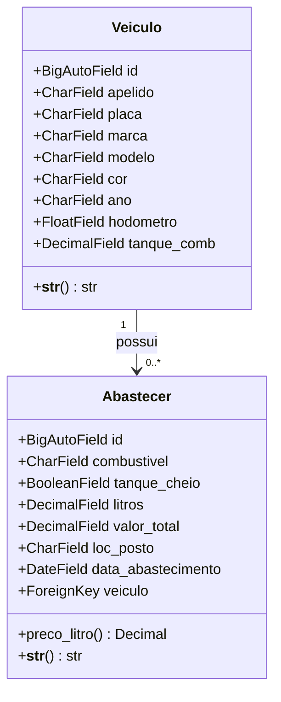

# C4 Code Level: `ecorodagem/models/`

## 1. Overview
- **Name**: EcoRodagem Domain Models (`ecorodagem/models`)
- **Description**: Define as entidades de banco de dados (ORM Django) e formulários auxiliares de registro do sistema EcoRodagem.
- **Location**: [`ecorodagem/models/`](file:///c:/Users/davic/OneDrive/Documentos/GitHub/EcoRodagem/ecorodagem/models)
- **Language**: Python 3 / Django ORM
- **Purpose**: Persistência e representação estrutural de Veículos, Abastecimentos e dados de registro de usuários.

---

## 2. Code Elements

### 2.1 Classes e Modelos

#### [`Veiculo` (em `veiculo.py`)](file:///c:/Users/davic/OneDrive/Documentos/GitHub/EcoRodagem/ecorodagem/models/veiculo.py#L3-L18)
- **Description**: Modelo principal que representa um veículo cadastrado no sistema.
- **Location**: [`ecorodagem/models/veiculo.py`](file:///c:/Users/davic/OneDrive/Documentos/GitHub/EcoRodagem/ecorodagem/models/veiculo.py#L3-L18)
- **Attributes**:
  - `apelido`: `CharField(max_length=50)`
  - `placa`: `CharField(max_length=10, unique=True, blank=False, null=False)`
  - `marca`: `CharField(max_length=50)`
  - `modelo`: `CharField(max_length=50)`
  - `cor`: `CharField(max_length=50, blank=True)`
  - `ano`: `CharField(max_length=11, blank=True)`
  - `hodometro`: `FloatField()`
  - `tanque_comb`: `DecimalField(max_digits=3, decimal_places=2)` *(Nota de diagnóstico: `max_digits=3` limita o tanque a `9.99` litros; corrigido parcialmente no duplicado `veiculos.py` para `max_digits=5`)*.
- **Methods**:
  - `__str__(self) -> str` ([L13-L14](file:///c:/Users/davic/OneDrive/Documentos/GitHub/EcoRodagem/ecorodagem/models/veiculo.py#L13-L14)): Retorna `"Apelido - (Marca Modelo) | Placa: PLACA"`.

#### [`Veiculo` (duplicado em `veiculos.py`)](file:///c:/Users/davic/OneDrive/Documentos/GitHub/EcoRodagem/ecorodagem/models/veiculos.py#L5-L15)
- **Description**: Arquivo duplicado do modelo `Veiculo` contendo `tanque_comb = models.DecimalField(max_digits=5, decimal_places=2)`. Não é importado pelas views atuais.

#### [`Abastecer` (em `abastecimento.py` e duplicado em `abastecer.py`)](file:///c:/Users/davic/OneDrive/Documentos/GitHub/EcoRodagem/ecorodagem/models/abastecimento.py#L4-L28)
- **Description**: Modelo que registra cada evento de abastecimento vinculado a um `Veiculo`.
- **Location**: [`ecorodagem/models/abastecimento.py`](file:///c:/Users/davic/OneDrive/Documentos/GitHub/EcoRodagem/ecorodagem/models/abastecimento.py#L4-L28) e [`ecorodagem/models/abastecer.py`](file:///c:/Users/davic/OneDrive/Documentos/GitHub/EcoRodagem/ecorodagem/models/abastecer.py#L4-L28)
- **Attributes**:
  - `combustivel`: `CharField(max_length=20, choices=COMBUSTIVEL_CHOICES, default='gasolina')` (`gasolina`, `etanol`, `diesel`, `gnv`)
  - `tanque_cheio`: `BooleanField(default=False)`
  - `litros`: `DecimalField(max_digits=3, decimal_places=2)` *(Nota: requer `max_digits=6` ou `10` para suportar mais de `9.99` litros)*
  - `valor_total`: `DecimalField(max_digits=10, decimal_places=2)`
  - `loc_posto`: `CharField(max_length=100, blank=True, null=True)`
  - `data_abastecimento`: `DateField()`
  - `veiculo`: `ForeignKey(Veiculo, on_delete=models.CASCADE)`
- **Methods**:
  - `preco_litro(self, Decimal) -> Decimal | int` (`@property`, [L20-L25](file:///c:/Users/davic/OneDrive/Documentos/GitHub/EcoRodagem/ecorodagem/models/abastecimento.py#L20-L25)): Calcula `self.valor_total / self.litros`. *(Nota de bug: recebe argumento extra `Decimal` em `@property`, o que causa `TypeError` ao ser acessado).*
  - `__str__(self) -> str` ([L27-L28](file:///c:/Users/davic/OneDrive/Documentos/GitHub/EcoRodagem/ecorodagem/models/abastecimento.py#L27-L28)): Retorna string descritiva do abastecimento.

#### [`registro` (em `registro.py`)](file:///c:/Users/davic/OneDrive/Documentos/GitHub/EcoRodagem/ecorodagem/models/registro.py#L4-L13)
- **Description**: Esboço de formulário (`forms.Form`) para cadastro de usuários.
- **Location**: [`ecorodagem/models/registro.py`](file:///c:/Users/davic/OneDrive/Documentos/GitHub/EcoRodagem/ecorodagem/models/registro.py#L4-L13)
- **Notes**: Possui erros de sintaxe/digitação (`forms.charField` com `c` minúsculo e tupla sem vírgula em `genero_choices`).

---

## 3. Dependencies
- **Internal**: `ecorodagem.models.veiculo.Veiculo` (importado por `abastecimento.py` e `abastecer.py`).
- **External**: `django.db.models`, `django.forms`, `decimal.Decimal`.

---

## 4. Relationships Diagram

