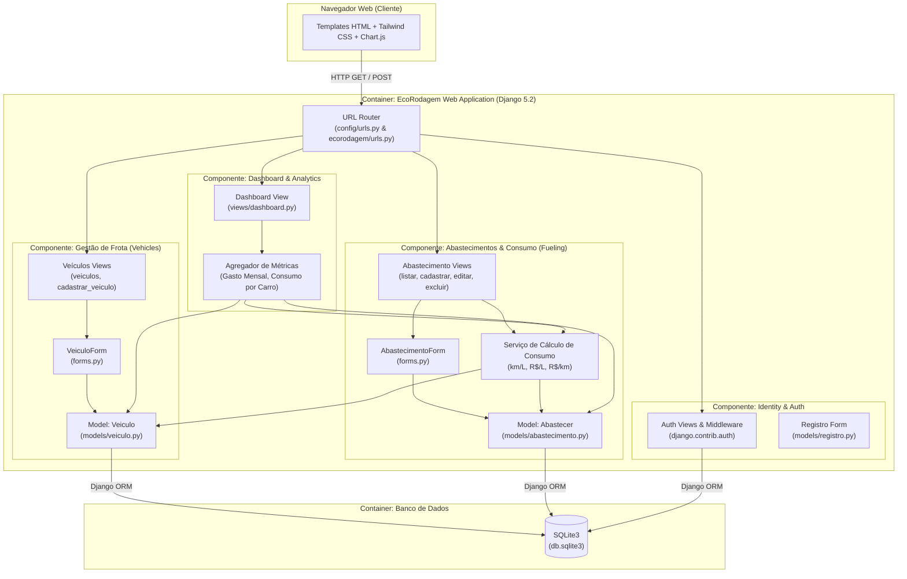

# C4 Component Level: Master Component Index (`EcoRodagem`)

## 1. Visão Geral dos Componentes do Sistema

O container principal **EcoRodagem Web Application (Django Monolith)** é decomposto em **4 componentes lógicos** que estruturam tanto o código atual (As-Is) quanto a evolução planejada (To-Be):

| Componente | Tipo | Tecnologia | Status Atual | Documentação |
| :--- | :--- | :--- | :--- | :--- |
| **1. Gestão de Frota (`VehicleManagement`)** | Django Module (Views, Forms, ORM) | Python / Django 5.2 | Parcialmente implementado | [c4-component-vehicles.md](file:///c:/Users/davic/OneDrive/Documentos/GitHub/EcoRodagem/C4-Documentation/c4-component-vehicles.md) |
| **2. Controle de Abastecimentos & Consumo (`FuelingAndConsumption`)** | Django Module + Domain Service | Python / Django 5.2 | Modelo base criado; Views e cálculo de média pendentes | [c4-component-fueling.md](file:///c:/Users/davic/OneDrive/Documentos/GitHub/EcoRodagem/C4-Documentation/c4-component-fueling.md) |
| **3. Dashboard & Analytics (`DashboardAndReports`)** | Django Views + Chart.js UI | Python / Django / Chart.js | UI pronta com dados estáticos; agregações pendentes | [c4-component-dashboard.md](file:///c:/Users/davic/OneDrive/Documentos/GitHub/EcoRodagem/C4-Documentation/c4-component-dashboard.md) |
| **4. Autenticação & Perfis (`IdentityAndAuth`)** | Django Auth Module | `django.contrib.auth` | Template de login e esboço de form criados | [c4-component-auth.md](file:///c:/Users/davic/OneDrive/Documentos/GitHub/EcoRodagem/C4-Documentation/c4-component-auth.md) |

---

## 2. Diagrama de Componentes (C4 Level 3)

