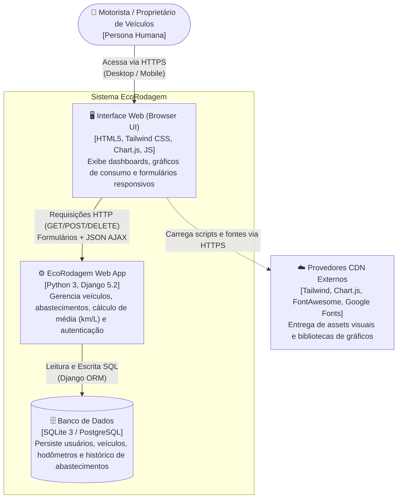

# C4 Container Level: EcoRodagem System (`c4-container`)

## 1. Visão Geral dos Containers

A arquitetura do sistema **EcoRodagem** adota o padrão **Monólito Modular Server-Side Rendered (Django MVT)** aprimorado com interatividade client-side (Tailwind CSS + Chart.js + Fetch API).

| Container | Tipo | Tecnologia | Descrição e Papel |
| :--- | :--- | :--- | :--- |
| **1. Interface Web (Client Browser UI)** | Web Frontend (SSR + JS) | HTML5, Tailwind CSS, Chart.js, Vanilla JS (`EcoRodagem`) | Renderiza o Dashboard, tabelas interativas de veículos/abastecimentos, gráficos de consumo e modais no navegador do motorista. |
| **2. EcoRodagem Web Application** | Backend Web Server | Python 3.12+, Django 5.2 (WSGI/ASGI) | Processa regras de negócio, autenticação de usuários, validação de formulários, cálculo de média de consumo (`km/L`) e preço por litro (`R$/L`). |
| **3. Banco de Dados Relacional** | Relational Database | SQLite 3 (`db.sqlite3`) *(ou PostgreSQL em produção)* | Armazena usuários, veículos cadastrados, histórico de abastecimentos e sessões. |

---

## 2. Diagrama de Containers (C4 Level 2)

---

## 3. Detalhamento dos Containers

### 3.1 EcoRodagem Web Application (`Django 5.2`)
- **Componentes Hospedados**:
  - [Gestão de Frota (`VehicleManagement`)](file:///c:/Users/davic/OneDrive/Documentos/GitHub/EcoRodagem/C4-Documentation/c4-component-vehicles.md)
  - [Controle de Abastecimentos & Consumo (`FuelingAndConsumption`)](file:///c:/Users/davic/OneDrive/Documentos/GitHub/EcoRodagem/C4-Documentation/c4-component-fueling.md)
  - [Dashboard & Analytics (`DashboardAndReports`)](file:///c:/Users/davic/OneDrive/Documentos/GitHub/EcoRodagem/C4-Documentation/c4-component-dashboard.md)
  - [Autenticação & Perfis (`IdentityAndAuth`)](file:///c:/Users/davic/OneDrive/Documentos/GitHub/EcoRodagem/C4-Documentation/c4-component-auth.md)
- **Especificação de Rotas e API**: Documentada em [apis/ecorodagem-web-api.yaml](file:///c:/Users/davic/OneDrive/Documentos/GitHub/EcoRodagem/C4-Documentation/apis/ecorodagem-web-api.yaml).

### 3.2 Banco de Dados (`SQLite 3`)
- **Arquivo de Persistência**: [`db.sqlite3`](file:///c:/Users/davic/OneDrive/Documentos/GitHub/EcoRodagem/db.sqlite3) configurado em [`config/settings.py`](file:///c:/Users/davic/OneDrive/Documentos/GitHub/EcoRodagem/config/settings.py#L79-L84).
- **Tabelas Principais**:
  - `auth_user` (Usuários do sistema)
  - `ecorodagem_veiculo` (Frota de veículos por usuário)
  - `ecorodagem_abastecer` (Registros de abastecimento com quilometragem, litros, valor e local)
