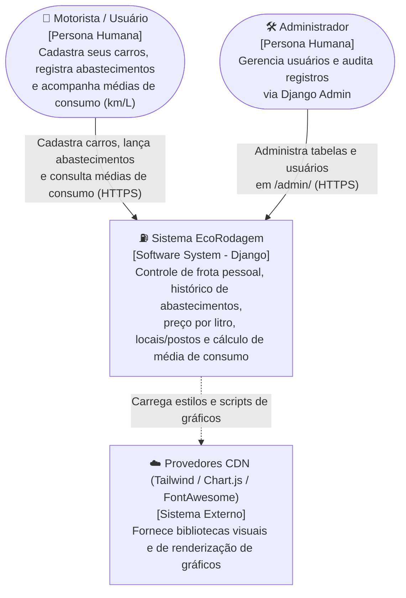

# C4 Context Level: EcoRodagem System (`c4-context`)

## 1. Visão Geral do Sistema (System Overview)
- **Descrição Curta**: A **EcoRodagem** é uma plataforma web para gestão de frotas pessoais e controle inteligente de abastecimentos e consumo de combustível.
- **Descrição Detalhada**: O sistema permite que proprietários de veículos cadastrem um ou mais carros e registrem cada abastecimento realizado (informando valor pago, litros, preço por litro, tipo de combustível, posto/localização e quilometragem atual no hodômetro). Com base nesses registros, a EcoRodagem calcula automaticamente a média de consumo (`km/L`), o custo por quilômetro rodado (`R$/km`) e apresenta relatórios e gráficos comparativos por mês, por veículo e por posto.

---

## 2. Personas

### 2.1 Motorista / Proprietário de Veículos (`Human User`)
- **Quem é**: Condutor ou gestor de frota familiar/pessoal que possui um ou mais veículos.
- **Necessidades e Objetivos**:
  - Manter histórico organizado de todos os carros e seus abastecimentos.
  - Descobrir o consumo real (`km/L`) de cada veículo com cada tipo de combustível (ex.: Gasolina vs. Etanol).
  - Controlar o orçamento mensal gasto com combustível e identificar quais postos oferecem melhor custo-benefício.
- **Funcionalidades Utilizadas**: Cadastro de Veículos, Registro de Abastecimento, Dashboard de Consumo e Relatórios de Postos.

### 2.2 Administrador do Sistema (`Human User`)
- **Quem é**: Desenvolvedor ou administrador responsável pela operação e suporte da instância EcoRodagem.
- **Funcionalidades Utilizadas**: Django Admin (`/admin/`) para auditoria de registros, suporte a usuários e manutenção cadastral.

---

## 3. Diagrama de Contexto do Sistema (C4 Level 1)

---

## 4. Principais Funcionalidades e Jornadas do Usuário (User Journeys)

### Jornada 1: Cadastro de Veículo na Frota
1. O **Motorista** acessa a seção **Meus Veículos** (`/veiculos/`) e clica em **Adicionar Veículo**.
2. Preenche os dados: Apelido (ex.: `"Meu Civic"`), Placa (`"ABC-1234"`), Marca, Modelo, Ano, Cor, Capacidade do Tanque (`L`) e Hodômetro inicial (`km`).
3. O sistema valida o formato da placa e unicidade, salva o veículo vinculado ao usuário e exibe na listagem da frota.

### Jornada 2: Registro de Abastecimento e Cálculo de Consumo Médio (`km/L`)
1. Após abastecer no posto, o **Motorista** clica em **Novo Abastecimento** (`/abastecimentos/cadastrar/`).
2. Seleciona o veículo, a data, o combustível (`Gasolina`, `Etanol`, `Diesel` ou `GNV`), informa os **Litros**, o **Valor Total** (ou Preço/Litro), o **Nome/Local do Posto**, o **Hodômetro Atual** do painel do carro e marca se foi **Tanque Cheio**.
3. O sistema **EcoRodagem**:
   - Calcula automaticamente o preço por litro ($\text{Valor Total} / \text{Litros}$).
   - Compara o `hodometro_atual` com o hodômetro do abastecimento anterior daquele veículo para calcular a distância percorrida ($\Delta \text{km}$) e a média de consumo ($\Delta \text{km} / \text{Litros}$).
   - Atualiza o hodômetro atual no cadastro do `Veiculo`.
   - Atualiza os indicadores e gráficos do **Dashboard**.

---

## 5. Documentação Relacionada (Navegação C4)
- **Nível 2 (Containers)**: [c4-container.md](file:///c:/Users/davic/OneDrive/Documentos/GitHub/EcoRodagem/C4-Documentation/c4-container.md) & [OpenAPI Spec](file:///c:/Users/davic/OneDrive/Documentos/GitHub/EcoRodagem/C4-Documentation/apis/ecorodagem-web-api.yaml)
- **Nível 3 (Componentes)**: [c4-component.md](file:///c:/Users/davic/OneDrive/Documentos/GitHub/EcoRodagem/C4-Documentation/c4-component.md)
  - [Componente: Gestão de Frota](file:///c:/Users/davic/OneDrive/Documentos/GitHub/EcoRodagem/C4-Documentation/c4-component-vehicles.md)
  - [Componente: Abastecimentos & Consumo](file:///c:/Users/davic/OneDrive/Documentos/GitHub/EcoRodagem/C4-Documentation/c4-component-fueling.md)
  - [Componente: Dashboard & Analytics](file:///c:/Users/davic/OneDrive/Documentos/GitHub/EcoRodagem/C4-Documentation/c4-component-dashboard.md)
  - [Componente: Autenticação & Perfis](file:///c:/Users/davic/OneDrive/Documentos/GitHub/EcoRodagem/C4-Documentation/c4-component-auth.md)
- **Nível 4 (Código)**:
  - [Models](file:///c:/Users/davic/OneDrive/Documentos/GitHub/EcoRodagem/C4-Documentation/c4-code-ecorodagem-models.md)
  - [Views](file:///c:/Users/davic/OneDrive/Documentos/GitHub/EcoRodagem/C4-Documentation/c4-code-ecorodagem-views.md)
  - [Core App & Templates](file:///c:/Users/davic/OneDrive/Documentos/GitHub/EcoRodagem/C4-Documentation/c4-code-ecorodagem-core.md)
  - [Config & Legacy](file:///c:/Users/davic/OneDrive/Documentos/GitHub/EcoRodagem/C4-Documentation/c4-code-config-and-legacy.md)
